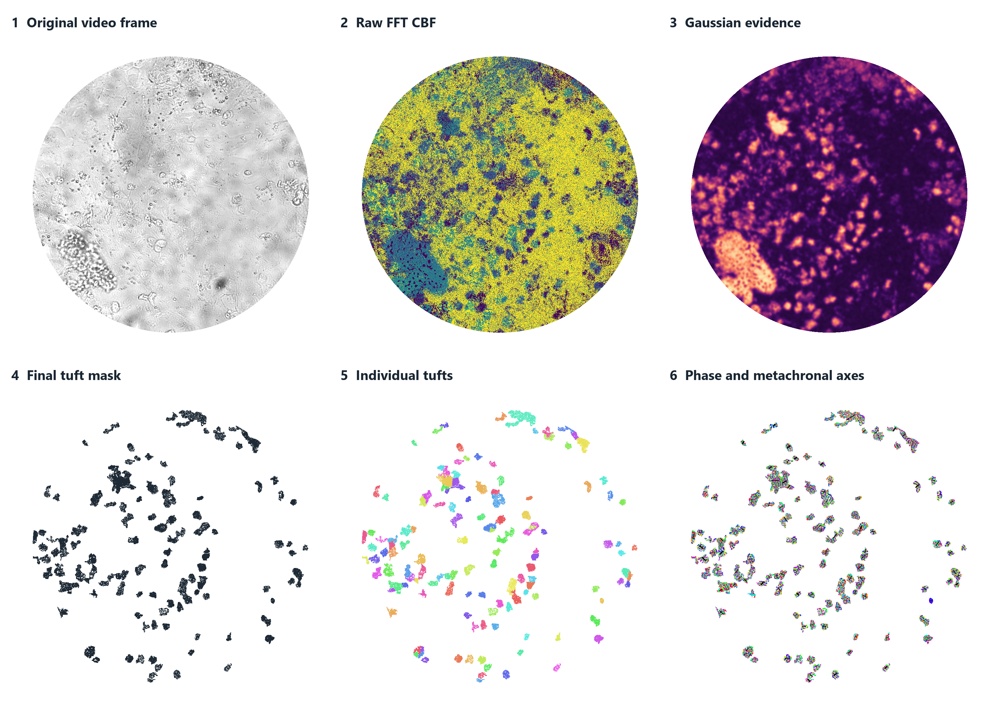

<h1 align="center">
  <picture>
    <source media="(prefers-color-scheme: dark)" srcset="docs/images/tufft-wordmark-dark.png">
    
  </picture>
</h1>

<p align="center">
  <strong>High-speed cilia video analysis</strong><br>
  Measure beating frequency, identify tufts, and explore metachronal axes.
</p>

<p align="center">
  <strong><a href="docs/USER_MANUAL.md">Start the desktop tutorial</a></strong>
  &nbsp;|&nbsp; <a href="https://github.com/stratton-lab/TuFFT/releases/latest">Download for Windows</a>
  &nbsp;|&nbsp; <a href="docs/CLI_TUTORIAL.md">CLI tutorial</a>
</p>

**TuFFT** was developed for high-speed videos of **ependymal cell cilia**. It can also be applied to other ciliated cell types, with analysis settings tuned and results validated for the preparation. See the [analysis workflow and methodology](docs/USER_MANUAL.md) and [guidance for other cell types](docs/USER_MANUAL.md#adapting-to-other-cell-types).

The guided Windows desktop application and Python CLI share the same analysis engine, including multi-worker batch processing.

- **In-vitro:** segment ciliated tufts and measure area, ciliary beat frequency (CBF), metachronal axis, and phase-tensor coherence.
- **Ex-vivo:** analyze full frames or per-video polygonal ROIs, with foreground filtering and ROI-level CBF summaries.
- Choose CSV fields and PNG plots, reuse settings, and monitor or cancel batch runs.

## Installation

| Goal | Start here |
| --- | --- |
| Windows desktop app | [Download the installer](https://github.com/stratton-lab/TuFFT/releases/latest), follow the [installation guide](docs/INSTALLATION.md#windows-installer), then the [desktop tutorial](docs/USER_MANUAL.md). |
| Python CLI | [CLI installation](docs/INSTALLATION.md#python-cli-only), then the [CLI tutorial](docs/CLI_TUTORIAL.md). |
| Developer setup | [Desktop source installation](docs/INSTALLATION.md#desktop-from-source-windows). |

The installer includes Python, scientific dependencies, and FFmpeg; no development tools are required. Download the **setup .exe** under release Assets, not GitHub's source-code ZIP. No GitHub account is required to download or clone this public repository.

Windows 10/11 x64 is supported. macOS desktop packaging and validation are in progress; no supported macOS installer is available yet.

## Analysis At A Glance

[](docs/USER_MANUAL.md)

An in-vitro example using **100 frames at 500 fps** and a circular ROI. Follow the [illustrated tutorial](docs/USER_MANUAL.md) to explore each stage and its settings.

## Quick Workflow

1. Choose in-vitro or ex-vivo.
2. Add videos or folders and select an output folder.
3. Set acquisition FPS, frame count, and ROI. Inspect FFT and filtering previews.
4. Select CSV measurements and PNG plots.
5. Review and run. Each job saves parameters, a manifest, logs, and selected results in a new folder.

Supported containers: `.avi`, `.mp4`, `.mov`, `.m4v`, `.mkv`, `.wmv`, `.mpg`, `.mpeg`; the codec must also be supported by FFmpeg. Batch videos share processing settings; ex-vivo custom ROIs may differ per video.

Follow the [illustrated desktop tutorial](docs/USER_MANUAL.md) for step-by-step setup. Its [practical guidance](docs/USER_MANUAL.md#practical-guidance) explains frame selection, memory and storage requirements, foreground-mask checks, and interpretation of metachronal axes.

## Source And Development

```text
src/                 React/TypeScript interface
src-tauri/           Rust/Tauri desktop host and icons
python/sidecar/      Python analysis engine and CLI
examples/            Editable CLI job configurations
tests/               Frontend, Rust, and Python checks
tools/               Build and verification utilities
docs/                Installation, tutorials, and integration reference
```

See [development and releases](docs/RELEASE_AND_GITHUB.md), the [job configuration reference](docs/contracts/job-config-v1.md), and [progress events](docs/contracts/events-v1.md).

This repository contains application source, tests, and user documentation. Installers are release assets, not Git files. Raw videos, experimental validation datasets, complete analysis runs, and manuscript materials are not included.
